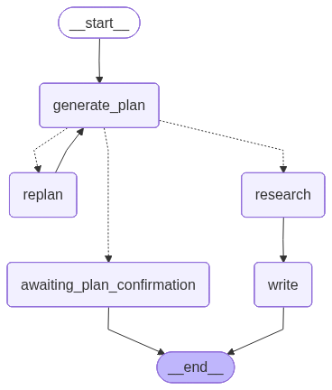

# DeepResearch — 多智能体深度研究助手

基于 LangGraph 的多智能体深度研究系统：输入一个问题，智能体自动完成 **研究计划 → 生成检索查询 → 网络研究 → 反思分析 → 撰写成文** 的完整闭环，产出结构化、带引用的中文研究报告。

## 功能特性

- **多智能体协作**：ResearchAgent（检索与反思）+ WriterAgent（提纲、草稿、润色与引用）分工配合
- **人在回路**：先生成研究计划，经用户「需求确认」后才进入深度研究，可随时调整需求
- **双通道消息流**：首次提交走异步任务队列（SSE 实时推送节点事件），后续对话走 LangGraph SDK 流式通道
- **过程可视化**：前端活动时间轴实时展示「生成计划 / 生成搜索查询 / 网络研究 / 反思分析 / 最终成文」各阶段
- **知识库与新鲜度管理**：研究事实存入 Milvus，支持时效性分级（市场 7d / 产品 30d / 策略 90d / 技术 180d）
- **检索增强**：KB 检索与 Web 搜索结果支持 gte-rerank 交叉编码器二次精排
- **用户体系**：注册 / 登录 / 会话管理，搜索缓存与限流（QPS 控制）
- **多模型支持**：可配置多个 LLM（`AVAILABLE_MODELS`），前端随时切换

## 系统架构



| 子图 | 说明 |
| --- | --- |
| [基础图](docs/images/基础图.png) | 最小研究闭环 |
| [ResearchAgent 子图](docs/images/ResearchAgent子图.png) | 检索 + 反思循环 |
| [WriterAgent 子图](docs/images/WriterAgent子图.png) | 提纲 → 草稿 → 润色引用 |
| [WriterAgent 带评审](docs/images/WriterAgent-带评审子图.png) | 草稿评审回流版本 |
| [人类参与版](docs/images/人类参与版.png) | 计划确认的人工节点 |

## 技术栈

| 层 | 技术 |
| --- | --- |
| 智能体编排 | LangGraph（checkpoint、stream、人在回路中断恢复） |
| 后端服务 | FastAPI + LangGraph Runtime（端口 2024），SSE 事件流 |
| 前端 | React 18 + TypeScript + Vite + Tailwind CSS v4 + shadcn/ui |
| 存储 | PostgreSQL（用户表 + checkpoint）、Redis（会话 / 缓存 / 任务队列 / 事件流）、Milvus（研究事实向量库） |
| LLM / 工具 | OpenAI 兼容接口（默认 DashScope），MCP Web 搜索，DashScope Embedding / Rerank |

## 快速开始

### 依赖服务

需要本机运行：PostgreSQL（5432）、Redis（6379）、Milvus（19530，可用 `docker-compose.milvus.yml` 一键启动）。

### 后端

```bash
cd backend
cp .env.example .env   # 填写 APP_TOKEN、EMBEDDING_API_KEY 等密钥
pip install -e .
langgraph dev --no-browser --no-reload --allow-blocking
```

Windows 也可直接运行根目录 `run_backend.bat`。

### 前端

```bash
cd frontend
npm install
npm run dev
```

访问 `http://localhost:5173/app/`（Vite 已将 `/api` 等请求代理到 2024 端口的 LangGraph 服务）。

## 配置说明

后端环境变量见 [backend/.env.example](backend/.env.example)，模型列表、KB 新鲜度模式、重排序开关等均在其中注释说明；详见 [backend/模型配置说明.md](backend/模型配置说明.md)。

## 测试与评测

```bash
cd backend
pytest test/          # 单元测试
python eval/run_eval.py   # 研究质量评测（输出 eval_report_*.json）
```

## 目录结构

```
backend/
  src/agent/        # 智能体：graph / research_agent / writer_agent / kb / auth / db
  eval/             # 评测集与判分脚本
frontend/
  src/components/   # 登录页 / 欢迎页 / 聊天视图 / 活动时间轴 / 输入表单
docs/images/        # 架构图
```
