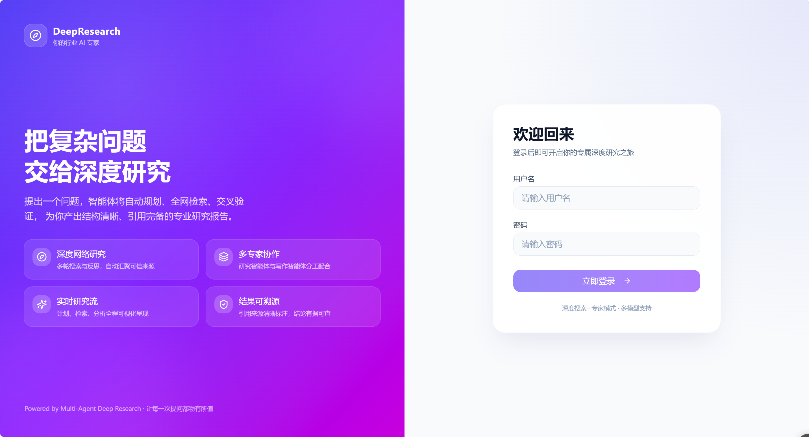
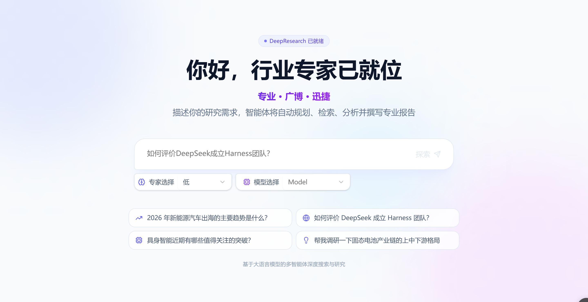
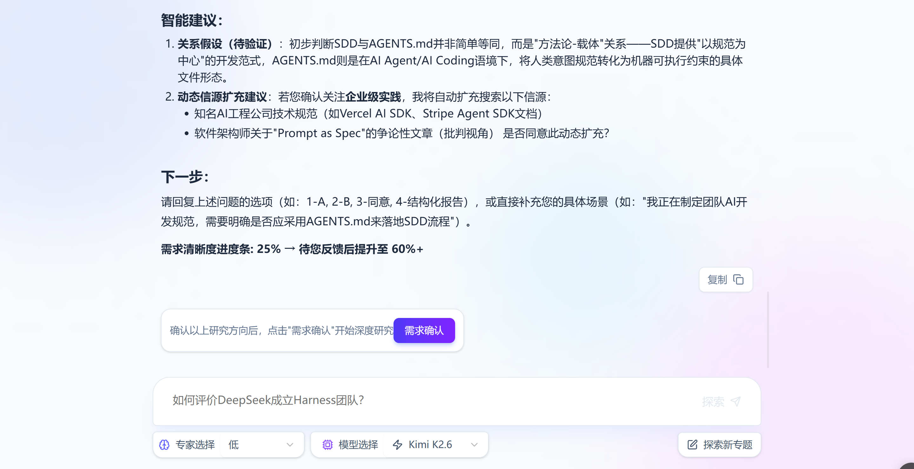

# DeepResearch — 多智能体深度研究助手

基于 LangGraph 的多智能体深度研究系统：输入一个问题，智能体自动完成 **研究计划 → 生成检索查询 → 网络研究 → 反思分析 → 撰写成文** 的完整闭环，产出结构化、带引用的中文研究报告。

## 界面预览

以下截图来自本地隔离演示环境，使用示例账号与资料，展示角色登录、研究问答及计划确认等页面。

**登录页**：左侧为品牌展示区（渐变背景 + 四大功能卡片），右侧为登录表单。登录接口由后端 JWT 鉴权保护，未登录访问任意页面会被重定向到这里。



**首页**：中央为研究需求输入框，下方可切换「专家选择」（低 / 中 / 高研究深度）与「模型选择」（多 LLM 下拉切换）；再下方提供 4 个示例问题，点击即可直接发起研究。



**对话计划确认页**：智能体先对模糊需求进行澄清提问（给出智能建议与下一步选项），并实时显示「需求清晰度进度条」；确认研究方向后点击「需求确认」按钮，才正式进入深度研究流程，实现人在回路。



## 功能概览

- **登录与用户管理**：账号密码注册 / 登录，JWT 鉴权；会话信息写入 Redis，浏览器关闭后凭 Cookie 恢复登录态，无需重复登录。
- **子图化多智能体协作**：将单体图重构为 MainGraph 主图（制定计划 + 编排） + ResearchAgent 子图（搜索 → 评估 → 补搜的内循环）+ WriterAgent 子图（提纲 → 草稿 → Critic 审稿，评分低于 6 分自动修订，最多 3 轮），主图与各智能体通过共享状态传递中间产物。
- **人在回路（Human-in-the-loop）**：智能体先产出研究计划并暂停等待；用户点击「需求确认」后通过 checkpoint 中断恢复机制继续执行；需求模糊时先进入澄清问答循环，实时反馈需求清晰度百分比。
- **双通道消息流**：首轮提问写入 Redis Streams 任务队列（`XADD` 入队、消费组 `XREADGROUP` + `XACK` 的 at-least-once 消费），处理完成后写入事件流，前端通过 SSE 订阅并支持 `Last-Event-ID` 断线重连；后续对话走 LangGraph SDK 流式通道（token 级逐字输出），两通道共用同一套消息渲染组件。
- **过程可视化**：前端活动时间轴实时展示「生成计划 / 生成搜索查询 / 网络研究 / 反思分析 / 最终成文」各阶段及子事件，流式卡片内嵌时间轴，研究进展一目了然。
- **全异步与流式**：按 LLM 调用 → Agent → Node → 知识库四阶段渐进异步化，双模共存平滑迁移；token 级流式链路为 OpenAI stream → `astream_step` → Redis Streams `XADD` → SSE → 前端，流式失败 3 次自动回退非流式；仅计划生成与润色成文两个长输出节点启用流式，兼顾吞吐与体验。
- **异常分类与分级重试**：异常统一分为 `TransientError`（3 次重试，退避 1.5 / 3 / 4.5s，MCP 429 单独延长为 5 / 10 / 15s）与 `PermanentError`（零重试快失败），18 处分散重试收敛为统一装饰器；认证类错误失败耗时从约 30s 降至 0s。
- **鲁棒 JSON 提取**：LLM 结构化输出解析采用 4 级降级（围栏正则 → 括号平衡枚举候选 + 尾逗号清理 → 最长候选包裹 → 返回原文），解析成功率从约 80% 提升至 95%+。
- **研究知识库与新鲜度管理**：研究过程中抽取的事实存入 Milvus 向量库（IVF_FLAT 索引，10 万级事实容量）；事实按主题自动分级时效（市场 7 天 / 产品 30 天 / 策略 90 天 / 技术 180 天），按 `max(0.3, 1-age/(max_age*2))` 公式衰减；支持 off / inform / freshness / lifecycle 四档模式，环境变量一键切换。
- **检索增强（Rerank）**：知识库召回扩为 `max(top_k*3, 20)` 后与 Web 搜索结果合并，使用 DashScope gte-rerank 交叉编码器二次精排——比 LLM 逐条打分快 10-50 倍、成本低一个数量级；重排失败自动直通原始结果，永不阻断主链路。
- **搜索缓存与限流**：搜索结果按查询哈希 `SETEX` 缓存 1 小时，跨请求命中率 0% → 60-70%，知识复用降低搜索 API 调用 20-30%；令牌桶限流默认 12 QPS（`WEB_SEARCH_MAX_QPS`），429 错误率从约 30% 降至 5% 以下；Redis 不可用时自动降级为进程内内存缓存。
- **多模型支持**：通过 `AVAILABLE_MODELS` 环境变量配置多个 LLM（模型 ID、显示名、图标颜色），OpenAI 兼容协议不绑定厂商，前端下拉随时切换，仅改环境变量即可整体换模型。
- **引用可溯源**：最终报告中的关键论断均带来源角标，对应检索阶段收集的 URL 证据；评测组件对引用逐条做 valid 有效引用 / weak 弱引用 / content_mismatch 内容不支撑 / url_not_found 地址不存在 四态判定。
- **大模型安全防护**：前端 react-markdown 默认转义防 XSS；全链路 Pydantic 结构化输出校验；模型列表只允许环境变量覆盖、防运行时篡改； Embedding 接口 401/403 永久失败、429/5xx 重试 3 次。
- **测试与评测**：pytest 六层测试体系（纯函数 / Mock / 异步 / 异常专项 / 集成 / KB 生命周期），297 个用例全量约 60 秒；内置 LLM-as-Judge 评估框架，E2E 按事实准确性 / 覆盖度 / 逻辑结构 / 时效性 / 引用质量 5 维度 1-5 分打分，支持组件级链路与低分维度归因。

## 系统架构


| 子图 | 说明 |
| --- | --- |
| [基础图](docs/images/基础图.png) | 最小研究闭环 |
| [ResearchAgent 子图](docs/images/ResearchAgent子图.png) | 检索 + 反思循环 |
| [WriterAgent 子图](docs/images/WriterAgent子图.png) | 提纲 → 草稿 → 润色引用 |
| [人类参与版](docs/images/人类参与版.png) | 计划确认的人工节点 |

## 技术栈

| 层 | 技术 |
| --- | --- |
| 编排 | LangGraph：StateGraph 条件边、Send 并行扇出、子图嵌套、checkpoint 中断恢复、双模流式 |
| 后端服务 | FastAPI + LangGraph Runtime（2024 端口）；基于 Redis Streams 的轻量任务队列（消费组 + 断线重连） |
| 前端 | React 18 + TypeScript + Vite + Tailwind CSS v4 + shadcn/ui，SSE 订阅与 SDK 流式双通道渲染 |
| LLM / 工具 | OpenAI 兼容协议（默认 DashScope，不绑定厂商）；阿里百炼 MCP Web 搜索 |
| 存储 | PostgreSQL（用户表 + checkpoint）；Redis（会话 / 缓存 / 任务队列 / 事件流）；Milvus 自托管（IVF_FLAT，数据不出域） |
| 检索与重排 | DashScope Embedding + gte-rerank 交叉编码器精排 |
| 评估 | LLM-as-Judge：Pydantic 结构化评分、E2E 5 维度 + 组件级引用四态判定 |
| 测试 | pytest 六层体系（297 用例，全量约 60s），可挂 pre-commit |
| 部署 | `docker-compose.milvus.yml` 一键启动 Milvus；前后端脚本一键启动 |

## 目录结构

```text
deepResearch_system/
├── backend/                          # 后端服务（LangGraph 多智能体）
│   ├── src/agent/                    # 核心智能体模块
│   │   ├── app.py                    # FastAPI 应用入口（含 SSE 事件接口）
│   │   ├── graph.py                  # 主图定义（计划 → 确认 → 研究 → 成文）
│   │   ├── state.py                  # 共享状态数据结构
│   │   ├── configuration.py          # 系统配置（模型列表 / KB 模式 / 限流等）
│   │   ├── prompts.py                # 提示词模板
│   │   ├── base_agent.py             # 基础智能体类
│   │   ├── tools_and_schemas.py      # 工具与 Pydantic 模式定义
│   │   ├── post.py                   # 报告后处理（引用补全等）
│   │   ├── search_cache.py           # 搜索结果 Redis 缓存
│   │   ├── reranker.py               # gte-rerank 交叉编码器重排
│   │   ├── task_queue.py             # Redis Streams 任务队列与事件流
│   │   ├── exceptions.py             # 异常分类（瞬态 / 永久）与分级重试
│   │   ├── logger.py / utils.py
│   │   ├── auth/                     # 登录注册、JWT、会话中间件
│   │   ├── db/                       # PostgreSQL 引擎与表模型
│   │   ├── kb/                       # 知识库：事实抽取 / 存储 / 生命周期
│   │   ├── llm/                      # LLM 统一接口
│   │   └── sub_agents/               # ResearchAgent / WriterAgent 子图
│   ├── eval/                         # LLM-as-Judge 评测框架
│   ├── test/                         # pytest 六层测试
│   ├── langgraph.json                # LangGraph 部署配置
│   └── .env.example                  # 环境变量模板
├── frontend/                         # 前端应用（React + Vite）
│   ├── src/
│   │   ├── components/               # 登录页 / 欢迎页 / 聊天视图 / 时间轴 / 输入表单 / ui
│   │   ├── context/                  # 登录态上下文
│   │   ├── lib/                      # 工具函数
│   │   ├── App.tsx / main.tsx / global.css
│   └── vite.config.ts                # /api 等请求代理到 2024 端口
├── docs/images/                      # 界面截图与架构图
├── docker-compose.milvus.yml         # Milvus 一键启动
├── run_backend.bat / run_fontend.bat / run.sh
└── README.md
```


## 快速开始

### 环境准备

- **Python 3.11+**（`pyproject.toml` 要求 `>=3.11,<4.0`）
- **Node.js 22.18+ 与 npm**（或 yarn / pnpm）
- **Docker**：用于运行 PostgreSQL 与 Redis（Milvus 可用根目录 `docker-compose.milvus.yml` 一键启动）
- **Embedding 服务**：默认使用阿里百炼的向量模型（可改用其他 OpenAI 兼容的在线向量模型）；也可本地部署 Ollama，拉取 `EMBEDDING_MODEL` 指定的模型（默认 bge-m3，向量维度 1024）
- **大模型 API Key**：OpenAI 兼容协议（默认阿里百炼 DashScope），在 `.env` 中配置 `APP_TOKEN`、`LLM_BASE_URL` 等变量

### 依赖服务

需要本机运行：PostgreSQL（5432）、Redis（6379）、Milvus（19530，可用 `docker-compose.milvus.yml` 一键启动）。

### 后端

```bash
cd backend
cp .env.example .env   # 填写 APP_TOKEN、EMBEDDING_API_KEY 等密钥
pip install -e .
langgraph dev --no-browser --no-reload --allow-blocking
```

Windows 也可直接运行根目录 `run_backend.bat`。

### 前端

```bash
cd frontend
npm install
npm run dev
```

访问 `http://localhost:5173/app/`（Vite 已将 `/api` 等请求代理到 2024 端口的 LangGraph 服务）。

## 配置说明

后端环境变量见 [backend/.env.example](backend/.env.example)，模型列表、KB 新鲜度模式、重排序开关等均在其中注释说明；详见 [backend/模型配置说明.md](backend/模型配置说明.md)。

## 测试与评测

```bash
cd backend
pytest test/          # 单元测试
python eval/run_eval.py   # 研究质量评测（输出 eval_report_*.json）
```
